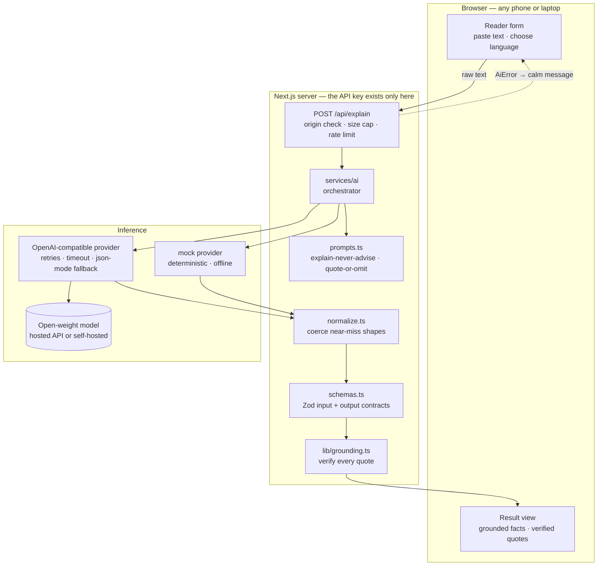

# Samajh

**Put in a letter you don't fully understand. Get back what it actually says — in your own language, with every fact quoted from the original.**

*Samajh* (समझ) means *understanding*. Built for the Hacktoberfest 2026 DEV Challenge, **Weekend Challenge: Build for a Friend**.

---

## The problem

My friend's mother is 68. She reads Telugu fluently and English slowly. Every few weeks an
official letter arrives — a bank notice, an insurance policy renewal, a hospital bill, a
rental agreement her son is signing — and the household stops while somebody tries to work
out what it wants.

The words are the problem, not the concepts. The letters are written in the register that
institutions write in, on purpose or not: *"the aforesaid lessee shall be liable for the
aforementioned charges accruing herefrom within the stipulated period."* She is not
confused by the idea. She is defeated by the sentence.

**How they cope today:** the letter sits on the table until someone visits. Or she reads it
four times and still isn't sure whether it says *pay by the 15th* or *you have 15 days from
receipt*. Or — and this is the one that worries me most — she quietly assumes it is probably
not important, and doesn't act.

**Why the existing options don't work:** machine translation of a legal or financial notice
into Telugu produces fluent, confident, sometimes wrong Telugu, with no way for her to tell
which parts are right. Which is worse than not translating it: she can't check the answer,
because checking means reading the English sentence she couldn't read in the first place.

## What this solves

Samajh reads the document and answers five questions, in the reader's language:

1. **What is this?** — what kind of document, from whom, and what that kind of document is for.
2. **What does it say?** — the gist, in plain words.
3. **What does it want from me, and by when?** — the asks, with the date the document itself gives.
4. **Which numbers and dates matter?** — amounts, references, deadlines, copied exactly.
5. **What might I miss?** — auto-renewals, penalties, conditions. And **what are you not sure about?**

And crucially, **every one of those answers carries a quote from the original**, which is
then checked against the text she supplied. If a quote can't be found in the document, the
app says so on the item itself.

That last part is the whole design. A model that can't be checked is useless to someone who
can't check it. **A quote she can compare against the paper in her hand — even if she reads
it slowly — is checkable.**

## Features

- **One screen, one flow.** Add the text, choose a language, press *Read it for me*. No
  accounts, no settings, no dashboards.
- **Text, a PDF, or a photograph.** Paste the words, add a `.txt`/`.md`/`.csv`, upload a PDF
  (its text is pulled out and shown back to you before anything is analysed), or photograph
  the page. A photo is shrunk on the reader's own device before anything is sent anywhere.
- **See every quote in its place.** Each fact, action and caution carries the line number it
  came from, and can be expanded to show the surrounding sentences with the quoted words
  highlighted — so the reader compares against the paper in their hand instead of trusting a
  summary.
- **Plain-language explanation in 12 languages**, including Telugu, Hindi, Tamil, Bengali,
  Marathi, Kannada, Malayalam, Gujarati, Punjabi, Urdu and Spanish.
- **Grounded output.** Model output is schema-validated, then every quote is verified
  against the source text and marked verified/unverified.
- **States uncertainty out loud** instead of hiding it: a confidence rating, a
  "what we are not sure about" section, and a warning when quotes don't check out.
- **Explains, never advises.** The prompt forbids legal, medical and financial advice, and
  the disclaimer survives copying and printing.
- **Copy and print.** The whole reading becomes neatly formatted text for a WhatsApp
  message or a sheet of paper on the fridge.
- **Runs with no API key at all** using the built-in offline `mock` provider, so you can
  see the entire flow before configuring anything.
- **Fails calmly.** Timeouts, rate limits, provider outages, unparseable model output and
  malformed input each produce a specific, human sentence — never a stack trace.

---

## How the AI is used

Not "AI-powered". The model does one specific job that rules cannot do: **turn arbitrary
official prose into structured, grounded facts.**

```
INPUT            Document text the reader pastes or uploads, or a photograph of the page.
                 Plus the language they want, plus an optional short note about who they are.

PREPROCESSING    Server-side only. Trim, validate, and clamp to AI_MAX_INPUT_CHARS so the
                 token cost, latency and data exposure stay bounded.

MODEL            An open-weight chat model behind an OpenAI-compatible endpoint,
                 asked for JSON only, at temperature 0.1.

OUTPUT           A JSON object: document type, plain-language summary, key facts, actions
                 with deadlines, cautions, questions, and explicit uncertainty.

VALIDATION       extract JSON → coerce near-miss shapes → validate against a Zod schema →
                 verify every quote against the source document.

APPLICATION      Only a fully validated result reaches the screen. Items whose quotes could
                 not be found are marked, and the confidence rating is shown next to the
                 document title, not buried.
```

The AI is not decoration here. Extract-a-deadline-from-a-bank-notice is not a regex: the
deadline is as likely to be *"within 15 days of the date hereof"* as *12/08/2026*, the
amount may be written in words, the obligation may be spread over three paragraphs, and the
whole thing may be in a language the reader half-knows. **This is the case where a language
model stops being a novelty and starts being the only thing that works** — and it is also
exactly the case where a model can be confidently wrong, which is why verification is not
optional.

### Why the quotes matter more than the summaries

Asking a model to explain a document is easy. Trusting it is the hard part.

If a model tells a 68-year-old that her loan is "probably fine", and it is wrong, she has no
way to know. So the prompt requires that **every claim carry a quote copied
character-for-character from the document**, and the application then independently checks
each quote against the text she supplied (`lib/grounding.ts`).

- No exact quote → the prompt says omit the item entirely.
- The quote wasn't checked out → the item is still shown, but marked *"we could not find this
  exact wording in the document you gave us"*, and the count is reported at the top.

Verification is deliberately forgiving about cosmetics (OCR turns `“` into `"`, copy-paste
turns a non-breaking space into a space) and strict about substance (a quote that is not in
the document is not in the document).

## Model selection

The requirement: **open-source or open-weight AI at the core**, with the licence described
accurately. These are not the same thing, and the difference matters:

| Model family | Licence | Honest description | Notes |
| --- | --- | --- | --- |
| **Qwen3** | Apache-2.0 | ✅ **open source** | Strong structured/JSON output, multilingual. **Recommended default.** |
| **Mistral Small** | Apache-2.0 | ✅ **open source** | Lighter; good latency. |
| **Gemma** | Gemma Terms of Use | ⚠️ **open-weight**, *not* open-source | Free to use and redistribute, but not an OSI-approved licence. Also a partner category in this challenge. |
| **Llama** | Llama Community Licence | ⚠️ **open-weight**, *not* open-source | Restricted above 700M MAU; not OSI-approved. |
| **Whisper large-v3** | MIT | ✅ **open source** | Only relevant if you add the voice path. |

**What this repository has actually been run against:** the built-in `mock` provider
end-to-end, and a stubbed OpenAI-compatible endpoint in the test suite. **It has not been
executed against a named hosted provider inside this repo** — so no provider-specific model
id is hard-coded or claimed. Set `AI_MODEL` to a model your chosen provider actually serves;
the app is provider-neutral by design, so this is the only change required.

**Why the model is swappable at all.** `services/ai/provider.ts` speaks one wire format:
OpenAI-compatible `POST /chat/completions`. That is what Groq, Together, Fireworks,
OpenRouter, DeepInfra, Hugging Face Inference Providers, vLLM, llama.cpp's `server` and
LM Studio all implement. Swapping the model, the host, or the whole company is an
`AI_MODEL` / `AI_BASE_URL` change — not a code change. Nothing in the UI knows a model
exists.

## Why open matters here — specifically

No hand-waving. Three reasons that are true of *this* architecture:

1. **Financial and legal documents should not need to leave a household's control to be
   understood.** The adapter talks to whatever endpoint you point it at. Because it is a
   plain OpenAI-compatible client, that endpoint can be a self-hosted server on a laptop or
   a home box, running open weights, with no third party in the path. The code supports
   that route; whether you take it is a deployment decision, and the README says so rather
   than pretending it's already local.

2. **A model that can be swapped can be upgraded without permission.** Translation and
   comprehension quality for Indic languages has moved fast, and no single vendor is best at
   all of them. When a better open-weight model appears for Telugu, `AI_MODEL` changes. No
   API migration, no reprocessing of anyone's data, no contract.

3. **The verification layer only makes sense with open models.** Grounding checks are cheap
   and local, so they run on every request. Cost and rate limits are the reader's to control,
   which is what makes it reasonable to verify every single quote instead of sampling.

**What is *not* claimed:** this project does not run inference on-device, and it does not
claim zero data egress. In the default configuration the document is sent to whichever
endpoint you configure. Privacy is a *deployment choice this architecture makes available*,
not a property the README gets to assume.

---

## Architecture



The server holds the credential; the browser never does. Nothing in `app/` or
`components/` imports a provider — they call one function, `explainDocument()`, and get
either a validated result or an `AiError`.

### Project structure

```
app/
  layout.tsx              App shell: landmarks, skip link, disclaimer, print styles
  page.tsx                Resolves AI status server-side, renders the reader
  globals.css             Design tokens, focus styles, reduced-motion, print rules
  icon.svg                Favicon: a document with the quote line picked out
  error.tsx               Error boundary: calm message, opaque code, retry
  not-found.tsx           A friendly 404 that points back at the reader
  api/explain/route.ts    The only endpoint that touches a model
  api/extract-text/route.ts  PDF → text, so the reader sees what was read
  api/health/route.ts     Liveness and readiness for containers; leaks nothing
components/
  Reader.tsx              Client component: text, photo, PDF, states, focus
  ResultView.tsx          Presentational result — every section, including uncertainty
  Quote.tsx               A quote, plus its verified/unverified marking
  QuoteLocation.tsx       The quote in context, with the match highlighted
lib/
  constants.ts            Every limit, shared by server and browser, zero deps
  errors.ts               AiError: kinds, user-facing messages, secret redaction
  files.ts                Is this a PDF? Is this text? (dependency-free)
  grounding.ts            Quote verification, and locating a quote in the source
  image.ts                Browser-side photograph preparation (shrink, re-encode)
  json.ts                 Recover JSON from fences, prose and trailing commas
  format.ts               Plain-text rendering for copy and print
  http.ts                 Origin check, body-size guard, client identity
  rateLimit.ts            In-memory fixed-window limiter
  languages.ts            The language list, in one place
  pdf.ts                  Server-only PDF text extraction (unpdf)
services/ai/
  index.ts                Orchestrator: validate → call → repair → verify
  provider.ts             OpenAI-compatible adapter (the only network code)
  model.ts                Environment → ModelConfig, with the missing-variable list
  prompts.ts              Versioned prompts; the safety rules live here
  schemas.ts              Zod contracts for input and output
  normalize.ts            Coerce near-miss model shapes before validation
  mock.ts                 Deterministic offline provider, honestly labelled as such
docs/
  dev-post-draft.md       The DEV Challenge write-up, staged and paste-ready
tests/                    153 tests across 16 files, plus a PDF fixture builder
Dockerfile                Three-stage image; no secret baked in, runs non-root
render.yaml               Render Blueprint; every credential marked sync: false
.dockerignore             Keeps the build context small
```

## Quickstart

```bash
git clone <your-fork-url> samajh
cd samajh
npm install
cp .env.example .env.local     # then fill in the AI_* values
npm run dev                    # http://localhost:3000
```

**See the whole flow with no API key at all** — set one line in `.env.local`:

```bash
AI_PROVIDER=mock
```

The app then runs on a deterministic offline provider. It is honestly labelled in its own
output, always reports `confidence: "low"`, and it says in plain words that no language
model read the document. Use it to see the plumbing; use a real model to see the product.

### Environment variables

| Variable | Required | Default | Purpose |
| --- | --- | --- | --- |
| `AI_PROVIDER` | no | `openai-compatible` | `openai-compatible` or `mock`. |
| `AI_BASE_URL` | yes¹ | — | OpenAI-compatible base URL, no trailing slash. |
| `AI_MODEL` | yes¹ | — | The model id your provider serves. |
| `AI_API_KEY` | yes¹ | — | Server-side credential. Never sent to the browser. |
| `AI_SUPPORTS_IMAGES` | no | `false` | Set `true` only if `AI_MODEL` is vision-capable. Controls whether the photo input is offered at all. |
| `AI_TIMEOUT_MS` | no | `45000` | Per-attempt timeout, after which the attempt aborts. |
| `AI_MAX_RETRIES` | no | `2` | Retries for 429 / 5xx / timeout / network only. |
| `AI_MAX_INPUT_CHARS` | no | `24000` | Hard ceiling on document text sent to the model. |
| `AI_JSON_MODE` | no | `auto` | `auto` tries `response_format`, and disables it for the process if the server rejects it. |

¹ Not required when `AI_PROVIDER=mock`. Missing variables are reported by name (never by
value) in the UI and the server log.

### Scripts

| Command | What it does |
| --- | --- |
| `npm run dev` | Development server |
| `npm run build` | Production build |
| `npm test` | Test suite (Vitest) |
| `npm run typecheck` | `tsc --noEmit` |
| `npm run lint` | ESLint, including accessibility rules |
| `npm run verify` | typecheck → lint → test → build |

## Running it somewhere

Three ways, in increasing order of effort. **No secret is ever baked into an image or a
repository file** — the `AI_*` values are read from the environment at run time, so the same
build can be deployed anywhere.

**Vercel** — import the repository and add the `AI_*` environment variables in the dashboard.
Next.js is detected automatically; no configuration needed.

**Render** — `render.yaml` is a Blueprint: **New → Blueprint**, point it at the repository.
Every credential is marked `sync: false`, which means Render prompts for it instead of reading
it from the file. Check it against the current
[Blueprint spec](https://render.com/docs/blueprint-spec) before relying on it.

**Docker, anywhere** — the image is three stages and runs as a non-root user:

```bash
docker build -t samajh .
docker run --rm -p 3000:3000 \
  -e AI_PROVIDER=openai-compatible \
  -e AI_BASE_URL=https://your-provider.example.com/v1 \
  -e AI_MODEL=your-open-weight-model-id \
  -e AI_API_KEY=... \
  samajh
```

The build uses `output: "standalone"`, so the final image carries no `node_modules` — only
traced files. Secrets are removed from the build context by `.dockerignore`.

**Health checking.** `GET /api/health` answers promptly with:

```json
{ "status": "ok", "aiReady": true, "provider": "openai-compatible", "supportsImages": false, "promptVersion": "2026-10-03.1" }
```

It answers `200` even when `aiReady` is `false`, deliberately: the app is working correctly, it
is simply unconfigured and says so on screen. A `5xx` would make an orchestrator restart a
container that has nothing wrong with it. The response never contains the credential.

**A note on the offline demo.** Set `AI_PROVIDER=mock` on any of these and the whole flow —
including the PDF path and the photograph UI — runs with no key and no cost. The provider
states in its own output that no language model read the document, and always reports
`confidence: "low"`.

---

## Failing well

A tool for someone who is already anxious about a letter should never say "Internal Server
Error". Every failure has a kind, a plain sentence and a retry policy:

| What happened | What the person is told | Retried? |
| --- | --- | --- |
| Provider is rate limiting us | *"The reader is busy right now. Wait a few seconds and try again — nothing was lost."* | yes, with backoff |
| Request timed out | *"Reading this took too long, so we stopped rather than leave you waiting."* | yes |
| Provider is down (5xx) | *"We couldn't read this document just now. Please try again in a moment."* | yes |
| Network unreachable | *"We couldn't reach the reader. Check your internet connection and try again."* | yes |
| Model output unparseable twice | *"We couldn't read this document reliably, so we'd rather say so than guess."* | no — one repair attempt first |
| Credentials missing or rejected | *"The document reader isn't set up yet… Whoever runs this app needs to add the AI settings."* | no |
| Document beyond the input ceiling | *"This document is too long to read in one go. Try one page at a time."* | no |
| Too many documents in a row | *"That is a lot of documents in a row. Please wait about N minutes…"* | no |

**The failure detail never reaches the browser.** `AiError` carries a technical `detail`
for the server log and a separate `userFacing` message for the screen, and the two are
asserted to be different in the test suite.

**If something unexpected breaks while rendering**, `app/error.tsx` catches it, shows a calm
sentence and offers a retry — displaying only Next.js's opaque error digest, never the
underlying message, which in production can contain internals. Unknown URLs land on a
`not-found.tsx` that points back at the one page that matters.

**And crucially: a bad model reply degrades the answer, it doesn't break the app.** If a
reply contains nine good facts and one missing a quote, the normaliser drops the one and
keeps the nine. Only if the reply is unusable twice does the request fail.

## Privacy

What this app does, concretely:

- **No accounts, no cookies, no database.** Nothing about a reader is stored, because there
  is nowhere to store it.
- **The document is not persisted.** It is held in the request and the response. There is no
  history feature, deliberately.
- **Only the minimum is sent.** The document text is clamped to `AI_MAX_INPUT_CHARS`; the
  optional "who is reading this?" note is capped at 300 characters and may be left blank.
- **Logs contain no document text and no quotes.** The grounding check logs only the *labels*
  of the items that failed (e.g. `keyFacts → Amount payable`).
- **Credentials are scrubbed before logging.** Provider error bodies sometimes echo the
  `Authorization` header; `redactSecret()` removes the configured key and any
  credential-shaped string before the detail is kept. This is unit-tested.
- **The API key never enters the browser bundle.** All model calls happen in a route handler;
  no client component imports the provider.

**The honest limitation:** in the default configuration, the document text *is* sent to
whichever inference endpoint you configure, and the provider's own data policies apply. The
architecture makes a self-hosted endpoint a one-line change, and the README says so instead
of claiming a privacy guarantee the default setup doesn't have.

## Accessibility

This is the target user's requirement, not a checklist item:

- Semantic landmarks (`header`/`main`/`footer`), a working **skip link**, and one `h1`.
- Every control has a real `<label>`; hints and counters are wired with `aria-describedby`.
- Loading is announced (`role="status"`, `aria-live="polite"`); errors are announced
  (`role="alert"`).
- **Focus is moved** to the result on success and to the error on failure, so keyboard and
  screen-reader users aren't stranded at the top of the form.
- A visible `:focus-visible` ring on everything; `prefers-reduced-motion` is respected.
- The submit button is *not* disabled when the text is too short — a disabled button can't be
  focused or explained, so the form says why instead.
- `eslint-config-next/core-web-vitals` runs `eslint-plugin-jsx-a11y` on every commit.
- A print stylesheet, because the most useful thing that can happen to a document is a
  readable page on a fridge.

---

## Testing

**153 tests across 16 files**, all passing, with **no network access and no API key** — the
provider is stubbed, the offline provider is real code, and the PDF fixture is a genuine
well-formed PDF built byte by byte.

| File | Covers |
| --- | --- |
| `tests/ai.test.ts` | The orchestrator: happy path, prompt contents, fence handling, repair-on-invalid, double-failure, truncation, invented quotes, photographs, missing configuration |
| `tests/route.test.ts` | The trust boundary: origin check, size cap, rate limiting, malformed JSON, field-level errors, the config error, image rejection |
| `tests/extractRoute.test.ts` | The PDF endpoint: extraction, non-PDF, no-text-layer, oversize, cross-origin, rate limit |
| `tests/healthRoute.test.ts` | Readiness reporting, and that the credential is never echoed |
| `tests/provider.test.ts` | The wire format: request shape, retries, retry-then-succeed, no-retry-on-4xx, `response_format` fallback, credential redaction, empty completion, array content |
| `tests/prompts.test.ts` | The safety rules: no advice, exact quotes or omission, gaps reported, photograph handling, exact JSON keys, wired into the prompt |
| `tests/grounding.test.ts` | Verification, and locating a quote: exact, case, line breaks, ellipsis, invented quotes, line numbers, trimmed context |
| `tests/pdf.test.ts` | Real extraction from a real PDF, the magic-byte check, whitespace tidying, scans, damaged files |
| `tests/normalize.test.ts` | Near-miss shapes: snake_case, synonyms, half-filled items, bad confidence values |
| `tests/json.test.ts` | Recovery of JSON from fences, prose and trailing commas |
| `tests/errors.test.ts` | Status→kind mapping, retryability, message hygiene, secret redaction |
| `tests/http.test.ts` | Same-origin enforcement, the body-size guard, client identity |
| `tests/files.test.ts` | PDF and text file recognition, including the near-miss cases |
| `tests/image.test.ts` | Accepted photo formats, base64 size arithmetic, human-readable sizes |
| `tests/format.test.ts` | The plain-text rendering that gets copied and printed |
| `tests/rateLimit.test.ts` | Window behaviour, with an injected clock |

```bash
npm run verify     # typecheck → lint → test → build
```

**Two real bugs were caught by these tests, and both would have shipped otherwise:**

1. `normalizeAction` confirmed an action's `quote` existed, then returned the object
   *without* it — quietly stripping the evidence out of every "what it asks you to do" item.
2. Cautions (`watchOutFor`) use `{ note, quote }`, not `{ label, value, quote }`. The generic
   grounded-item normaliser therefore returned `null` for every one of them, so the whole
   "worth reading twice" section silently disappeared on real model replies. Both now have
   regression tests.

## Technical challenges, and how they were solved

**Structured output with no vendor SDK.** The tempting move is to install one provider's
client, which welds the app to it. Instead, `provider.ts` speaks the OpenAI-compatible wire
format that most hosts implement, and asks for JSON with `response_format`. Not every server
accepts that field — some return `400`. Rather than fail, the adapter detects the specific
rejection, disables the field for the life of the process, and retries transparently.

**Trusting model output without discarding it.** Strict validation is right for the *core*
fields and wrong for the *optional* ones: rejecting an entire document because one of twelve
facts lacked a quote throws away eleven usable facts. So validation runs in two stages —
coerce and prune near-miss shapes first (`normalize.ts`), then validate strictly. The schema
stays the gate; the normaliser only removes noise the gate would trip over.

**Making output checkable, not just plausible.** `lib/grounding.ts` verifies every quote
against the source. It has to be forgiving about OCR and copy-paste cosmetics without being
forgiving about substance, so it tries three levels: normalised substring, ellipsis-split
fragments, then a punctuation-and-space-free comparison that still respects non-Latin
scripts (`\p{L}`, so Telugu isn't squeezed to an empty string and matched against everything).

**Distinguishing "the model broke" from "the document is unreadable".** They need different
messages and different retry policies. Every failure carries a `kind`; only the kinds that
can plausibly succeed are retried, and only the kinds that mean *our side* is at fault are
blamed on us.

**Toolchain compatibility, discovered not assumed.** Installing the latest majors produced
peer conflicts: `eslint@10` is outside the range of the plugins bundled with
`eslint-config-next`, and `typescript@7` is outside `typescript-eslint`'s `>=4.8.4 <6.1.0`,
which silently disables typed lint rules. Both were pinned to the highest *supported*
versions (`eslint@9`, `typescript@5.9`) rather than the newest, and `npm ls` is clean.

**Keeping the key out of the logs.** A provider that echoes the request's `Authorization`
header into its error body would write the API key to the server log. `redactSecret()` strips
the configured key *and* any credential-shaped string, and is tested with a realistic
"invalid key: gsk_…" body.

## What is deliberately not built

Being explicit about the edges, because the brief matters more than the surface area:

- **No built-in OCR.** A scanned PDF has no text layer, and this deliberately does not guess:
  it says so and points at the photograph path, which needs a vision-capable model. Genuinely
  reading a scan would mean running an OCR model, which is a different project.
- **No accounts, database, history or analytics.** A reported document is a financial or
  medical record. Storing it would be a liability, not a feature.
- **No streaming.** The result is a structured object, not prose; there is nothing useful to
  stream, and the schema can only be validated once it is complete.
- **The explanation is translated; the surrounding interface is not.** The chrome is English.
  The document's meaning — the part that matters — is in the reader's language.
- **No side-by-side document view.** Quotes are located in the source and shown in context,
  but the original is not rendered as a two-pane diff — this is used on a phone, in one hand,
  holding the letter in the other.
- **No spending cap** beyond the rate limiter. A production deployment would want a hard
  budget, not 8 requests per 5 minutes per IP.

## Credits and licensing

This project is **MIT licensed** — see `LICENSE` (© 2026 Duggi Venkata Siva Lalitaaditya).

Built on open-source work: [Next.js](https://nextjs.org), [React](https://react.dev),
[Tailwind CSS](https://tailwindcss.com), [Zod](https://zod.dev),
[unpdf](https://github.com/unjs/unpdf) (MIT, for PDF text extraction) and
[Vitest](https://vitest.dev). The application's AI runs on an **open-weight model** served by
whatever OpenAI-compatible endpoint you configure — this repository contains no vendor SDK.

The model licence table above is stated deliberately: **Qwen3 and Mistral are Apache-2.0 and
genuinely open source; Gemma and Llama are open-weight under their own terms and are not
OSI-approved open-source licences.** Please keep that distinction if you fork this.

---

## Hacktoberfest 2026 — DEV Challenge submission

Submitting to the **Weekend Challenge: Build for a Friend** as part of the
[Hacktoberfest 2026 DEV Challenges](https://dev.to/challenges).

- **The prompt** (identical across all five rounds): build something with open-source AI at
  its core — an open-weight model, an open-source agent harness, local inference, or a mix —
  and explain why open innovation matters for what you built.
- **This round's theme:** *Build for a Friend* — solve a real problem for one real person.
  See [The problem](#the-problem).
- **Required tag:** `hf26challenge`.
- **New work:** this repository was started and completed inside the challenge window.
- **AI disclosure:** this project was built with AI assistance, and the DEV post says so
  honestly.

**The hand-over.** The last mile of this project isn't code. The reading gets copied into a
message, or printed. Then it gets given to the person it was built for, and the app gets
judged by whether it changed anything for her — which is the only test that counts.


# samajh

