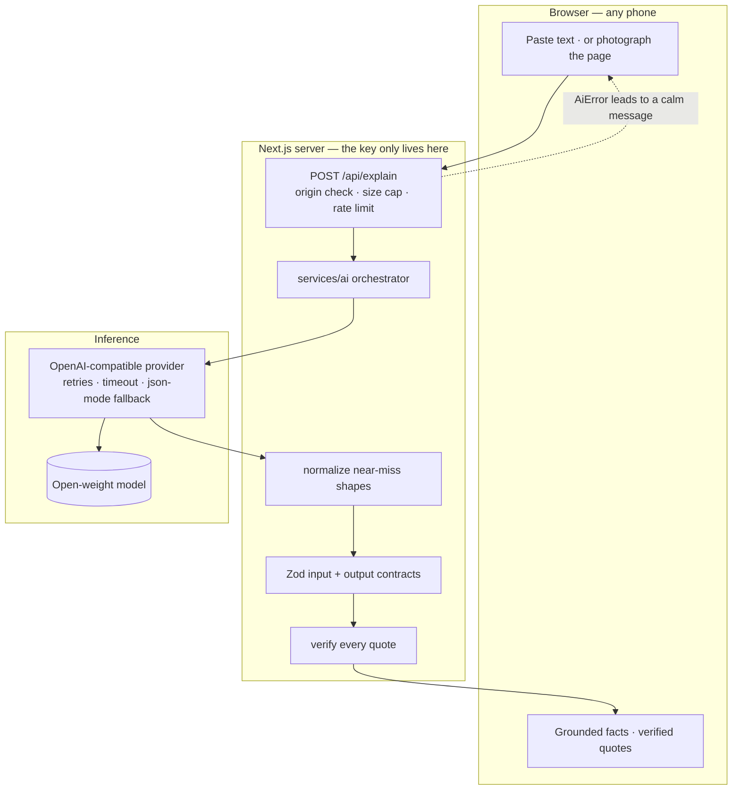

# DEV post draft — Hacktoberfest 2026, Weekend Challenge: "Build for a Friend"

> **Status: draft.** Written to the challenge's submission template and staged for the
> `#hf26challenge` tag. The personal details in **The letter**, **What I learned** and
> **The hand-over** are marked `<!-- FILL IN -->` — those are the parts only the author can
> supply, and the judges weight storytelling most heavily. Do not publish until they are real.
>
> Not a DEV post yet: the DevRelay MCP gateway's `create_article` tool was not available in
> the session that built this, so this is paste-ready text. When the gateway is enabled it can
> be staged as a DEV draft directly, with `ai_disclosure_level: some_ai`.

---

**Title:** Samajh — a reader for the letters my mother couldn't read

**Tags:** `hf26challenge`, `hacktoberfest`, `ai`, `opensource`, `privacy`

---

## The letter

<!-- FILL IN: the specific document, the specific day. One or two concrete sentences.
     "In [month] a letter arrived from [who]. She read it four times and still wasn't
     sure whether it said pay by the 15th or pay within 15 days." -->

## What I built

**Samajh** (समझ — "understanding") reads an official document and explains it in plain
language, in the reader's own language, with **every single claim quoted from the original
document and every quote checked back against it**.

You give it a letter. It gives you back five things:

1. **What this is** — the kind of document, who sent it, what that kind of document is for.
2. **The gist** — in short, in your language.
3. **What it wants from you, and by when** — the asks, with the date the document itself gives.
4. **The numbers and dates that matter** — amounts, references, deadlines, copied exactly.
5. **What is easy to miss** — auto-renewals, penalties, conditions — plus **what the reader
   is not sure about**.

It accepts pasted text, a plain-text file, or a photograph of the page. It speaks twelve
languages, including Telugu, Hindi, Tamil, Bengali, Marathi, Kannada, Malayalam, Gujarati,
Punjabi and Urdu.

## Why the quotes matter more than the summary

This is the whole project, so it gets its own section.

Asking a model to explain a document is easy. **Trusting it is the hard part.** If a model
tells a 68-year-old that her loan is "probably fine" and it is wrong, she has no way to find
out — because checking means reading the English sentence she could not read in the first
place.

So the prompt requires that every fact carry a quote copied character-for-character from the
document. Then the application **independently checks every quote against the text the reader
supplied**. A quote that cannot be found is still shown, but marked: *"we could not find this
exact wording in the document you gave us."* The count appears at the top of the result.

Verification is deliberately forgiving about cosmetics — OCR turns `“` into `"`, copy-paste
turns a non-breaking space into a space — and strict about substance. A quote that is not in
the document is not in the document.

**A tool someone cannot check is a tool they should not trust. A quote they can hold against
the paper in their hand is checkable — even if they read slowly.**

## How it works

## The AI, honestly

- **The model does the one job rules cannot do:** turn arbitrary official prose into
  structured, grounded facts. Pulling "pay within 15 days of the date hereof" out of a bank
  notice is not a regex — the amount may be written in words, the obligation spread across
  three paragraphs, the language one the reader half-knows.
- **Model output is never trusted blindly.** It is recovered from fences and prose, coerced to
  the expected shape, validated against a Zod schema, repaired once with its own specific
  failures quoted back, and *then* quote-checked against the source.
- **No vendor SDK.** The provider speaks the OpenAI-compatible wire format, so the model and
  the host are `AI_MODEL` / `AI_BASE_URL` — an environment change, not a code change.
- **Licence accuracy.** Qwen3 and Mistral are Apache-2.0 and genuinely open source. Gemma and
  Llama are **open-weight under their own terms and are not OSI-approved open-source
  licences**. The README says exactly which is which, because getting that wrong is easy and
  common.
- **It runs with no key at all.** `AI_PROVIDER=mock` exercises the entire flow offline, using a
  provider that states in its own output that no language model read the document, rather than
  pretending otherwise.

## Why open mattered here — specifically

1. **These documents should not have to leave a household to be understood.** The adapter is a
   plain OpenAI-compatible client, so the endpoint can be a self-hosted server running open
   weights, with no third party in the path. That is a deployment decision — and the README
   says so rather than claiming a privacy guarantee the default setup does not have.
2. **Indic-language quality is moving fast, and no single vendor leads it.** When a better
   open-weight model appears for Telugu, one environment variable changes.
3. **Verification only makes sense with open models.** Checking every quote costs money and
   latency. Being able to point at your own endpoint is what makes checking *all* of them
   reasonable instead of sampling a few.

## The parts I had to think hardest about

- **Validating output without throwing away the useful half.** Strict validation is right for
  required fields and wrong for optional ones: rejecting a whole document because one of
  twelve facts lacked a quote discards eleven usable facts. Splitting validation into a
  coercing pass and a strict pass fixed it.
- **Keeping the API key out of the logs.** Providers sometimes echo the `Authorization` header
  in an error body. `redactSecret()` scrubs it, with a unit test built on a realistic
  "invalid key: gsk_…" response.
- **Distinguishing "the model broke" from "the document is unreadable."** They need different
  messages and different retry policies, so every failure carries a kind, and only the kinds
  that could plausibly succeed are retried.
- **A photograph with nothing to check against.** When a reading comes from a photo and no
  text, the quotes *cannot* be verified. Rather than implying they were, the result says so
  plainly and suppresses the per-item warnings that would otherwise be wrong and alarming.

## What the tests caught

Two bugs that would otherwise have shipped: an action item that validated its quote and then
returned the object without it, and an entire section — "worth reading twice" — that the
normaliser silently discarded because cautions use `note` instead of `label`/`value`.

**120 tests across 12 files, with no network access and no API key required.**

## What I learned

<!-- FILL IN: be specific and honest. One or two things that genuinely surprised you.
     Candidates, if true: that asking for an exact quote changed the model's behaviour more
     than any other single instruction; that the normalise-then-validate split mattered more
     than the prompt wording did; that the hardest decision was what to show when the model
     was unsure. Keep only what is actually true. -->

## The hand-over

<!-- FILL IN — this is worth real points and the challenge explicitly asks for it.
     What did she say? Did it change anything? What did she still not trust? -->

---

*Built with AI assistance, and this post says so honestly. MIT licensed. The model licence table
in the README states plainly which models are open source and which are merely open-weight.*

